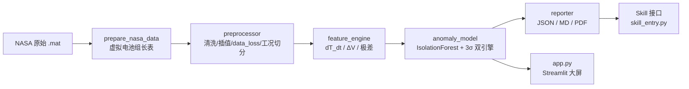

# battery_safety_agent

**储能系统电芯一致性巡检与安全诊断 Skill** —— 面向真实电站/BMS 的工业级电芯安全诊断工具链。
用 NASA 公开电池老化数据 + 双引擎（IsolationForest 无监督评分 + 动态 3σ 物理规则包络），
实现“数据清洗 → 机理特征 → 异常检测 → 结构化报告 → 可视化大屏”全链路。

> 面试一句话：*“通讯中断 10 秒？我的预处理管道会打上 data_loss 标签、不伪造插值，
> 检测引擎基于有效样本降级运行，恢复后无缝衔接。”*

---

## 一、为什么值得看（设计原则）

| 原则 | 实现 |
|---|---|
| 拒绝无条件填充 | 断点 ≤3s 插值；3~5s 插值并告警；**>5s 判定通讯离线，不伪造数据** |
| 不拿原始值直接训练 | 提取 **dT/dt（温升速率）、ΔV（中位数电压差）、组内极差** 等物理特征 |
| 拒绝单算法黑盒 | **AI 打分 + 规则阈值包络** 双引擎交叉校验，二级预警需“AI 确认 + 规则持续 ≥3 周期” |
| 工况过滤防误报 | 充电/放电/静置切分 + 滞回防抖 + **切换 5s 过渡区剔除** + 30s 抑制窗 |
| 输出可消费 | 标准化 JSON / Markdown / PDF 报告 + 数据质量审计 |

## 二、架构



## 三、快速开始（两条命令）

```bash
# 1. 创建虚拟环境并安装依赖（Python 3.13 已验证）
python -m venv .venv
.venv\Scripts\Activate.ps1        # Windows PowerShell
pip install -r requirements.txt

# 2. 启动可视化大屏
streamlit run app.py
```

命令行诊断（无界面）：

```bash
python skill_entry.py --data data/processed/nasa_pack_demo.csv --format pdf --outdir reports
```

运行测试：

```bash
pytest -q
```

## 四、数据说明（诚实披露）

- **来源**：NASA PCoE Battery Aging Data（B. Saha & K. Goebel, 2007），4 颗真实老化电芯
  `B0005 / B0006 / B0007 / B0018`（`data/raw/*.mat`）。
- **虚拟电池组构造**：原始数据是单电芯循环测试、采样不同步；本脚本把 4 颗电芯按同一循环协议
  对齐到 5s 公共时间网格，得到“同一时刻的多电芯同步读数”——即 BMS 对电池组同步采样的语义。
- **已知特性**：B0007 放电截止电压较深（构造协议差异），检测器将其识别为**一致性偏差（一级关注）**；
  B0018 为快衰减电芯（约 100+ 循环容量跌破 70%）。
- **故障注入**：公开老化数据几乎没有“突发热失控”，`src/fault_injection.py` 按机理**透明注入**
  热失控前兆（温升斜率 + 电压微跌），带 ground-truth，用于验证检测灵敏度与**提前量**。

## 五、演示场景（大屏侧边栏）

| 场景 | 预期结果 |
|---|---|
| 原始数据 | 一级关注：B0007/B0018 一致性偏差，无热失控误报 |
| 热失控前兆注入 | **二级预警**：注入后约 3 分钟报警，早于 60°C 绝对阈值（提前量验证） |
| 通讯中断 10s | 打 data_loss 标签、不插值、不崩溃，恢复后正常衔接 |
| 电压毛刺注入 | 滑动中值滤波剔除，毛刺计数审计 |

## 六、目录结构

```
battery_safety_agent/
├── data/raw/                # NASA .mat（自行下载，见下）
├── data/processed/          # 虚拟电池组长表 CSV（脚本生成）
├── scripts/prepare_nasa_data.py
├── src/
│   ├── preprocessor.py      # 数据清洗、插值、data_loss、工况切分
│   ├── feature_engine.py    # 电化学物理特征（dT/dt、ΔV、极差）
│   ├── anomaly_model.py     # 双引擎：IsolationForest + 动态3σ
│   ├── reporter.py          # JSON / Markdown / PDF 报告
│   └── fault_injection.py   # 透明故障注入（演示/验证）
├── app.py                   # Streamlit 可视化大屏
├── skill_entry.py           # 标准化 Skill 接口 + CLI
├── tests/                   # pytest（17 项）
└── requirements.txt
```

## 七、数据下载（.mat 文件）

`data/raw/` 需要放入 `B0005.mat / B0006.mat / B0007.mat / B0018.mat`
（来自 NASA Battery Data Set，约 4-16 MB/个）：

```powershell
cd data/raw
curl.exe -L -o B0005.mat https://raw.githubusercontent.com/changyeon99/Battery-Data-Set/main/B0005.mat
curl.exe -L -o B0006.mat https://raw.githubusercontent.com/changyeon99/Battery-Data-Set/main/B0006.mat
curl.exe -L -o B0007.mat https://raw.githubusercontent.com/changyeon99/Battery-Data-Set/main/B0007.mat
curl.exe -L -o B0018.mat https://raw.githubusercontent.com/changyeon99/Battery-Data-Set/main/B0018.mat
```

然后生成处理后的长表：

```bash
python scripts/prepare_nasa_data.py
```

## 八、面试话术库

**Q：为什么 dT/dt 异常比单纯看 T_max 更早发现热失控？**
> 国标滞后阈值是 60°C 绝对温度——那是“已经烧起来”的判据。内短路初期产热速率上升，
> **温升斜率 dT/dt 会先于温度绝对值突变**。本系统在温升斜率超出动态包络且持续 3 个采样周期时
> 即发出二级预警，演示场景中**比 60°C 阈值提前数分钟**捕捉到微短路前兆。

**Q：通讯中断 10 秒会发生什么？**
> 断点 >5s 被判定为 `data_loss`，置 NaN 且**不做伪造插值**；特征与检测基于有效样本
> 降级运行；恢复后经中值滤波与工况校验无缝衔接，并在数据质量审计中记录离线事件与时长。

**Q：会不会误报？**
> 三层防护：工况切换 5s 过渡区剔除 + 切换后 30s 告警抑制窗（电流阶跃毛刺）；
> 物理规则按“电芯×工况”分别滚动建包络；二级预警必须 AI 与规则同时确认且持续。

## 九、引用与致谢

- Saha, B., & Goebel, K. (2007). *Battery Data Set*, NASA Prognostics Data Repository,
  NASA Ames Research Center, Moffett Field, CA.
- 数据镜像：GitHub `changyeon99/Battery-Data-Set`。

---
*仅供学习与求职作品集使用，不构成任何商业产品的安全认证。*
