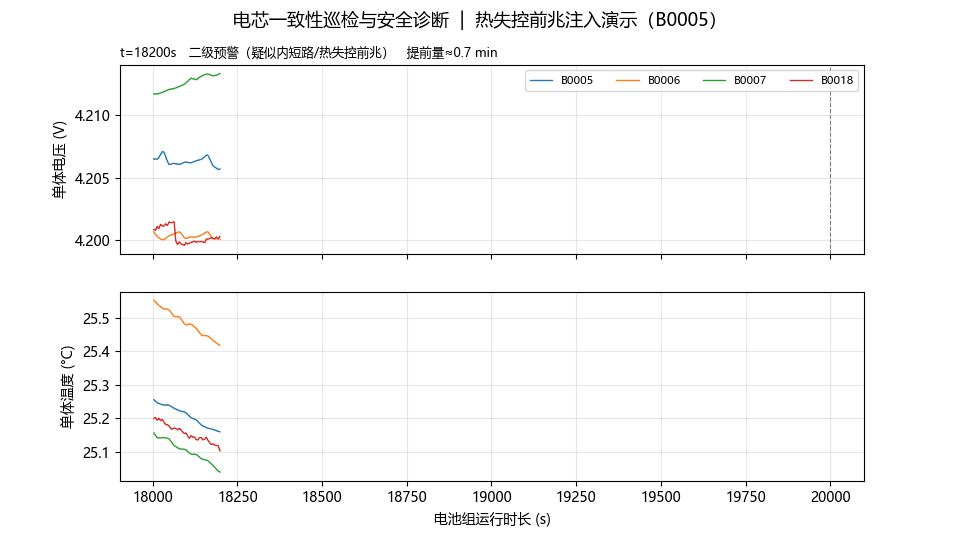
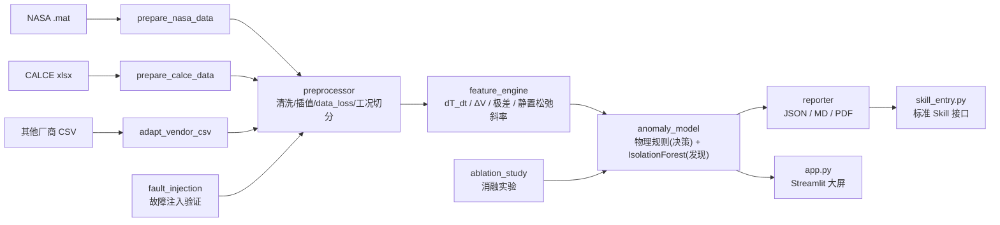

# battery_safety_agent

**储能系统电芯一致性巡检与安全诊断 Skill** —— 面向真实电站/BMS 的工业级电芯安全诊断工具链。
用**两套真实公开数据集**（NASA PCoE + 马里兰大学 CALCE）验证，实现
“数据清洗 → 机理特征 → 双引擎异常判定 → 分级预警 → 结构化报告 → 可视化大屏”全链路。

> 面试一句话：*“通讯中断 10 秒？预处理会打上 data_loss 标签、不伪造插值，检测基于有效样本降级运行，
> 恢复后无缝衔接。热失控前兆？温升斜率比 60°C 绝对阈值早数分钟报警，实测提前量 0.5 分钟，
> 而单用 IsolationForest 会**滞后 102 分钟**。”*



---

## 一、核心设计原则

| 原则 | 实现 |
|---|---|
| 拒绝无条件填充 | 断点 ≤3s 插值；3~5s 插值并告警；**>5s 判定通讯离线，不伪造数据** |
| 自适应采样周期 | 采样周期超过断点阈值时自动等比放大（NASA 5s、CALCE 30s 均可直接跑） |
| 不拿原始值直接训练 | 提取 **dT/dt、ΔV（中位数偏离）、ΔT、组内极差、静置自松弛斜率** 等物理特征 |
| **物理规则决策、AI 负责发现** | 二级预警由可解释的物理判据独立触发，AI 不具备否决权（详见第五节） |
| 阈值标定不泄露 | AI 阈值与归一化区间在 `fit()` 阶段由健康基线固化，不在测试批次上现算 |
| 工况过滤防误报 | 充放电/静置切分 + 滞回防抖 + 切换 5s 过渡区剔除 + 30s 告警抑制窗 |
| 斜率只在同段内计算 | 同一电芯×循环×相内差分，消除多段数据拼接产生的假温升 |
| 输出可消费 | 标准 JSON / Markdown / PDF 报告 + 数据质量审计 |

## 二、架构



## 三、快速开始

```bash
python -m venv .venv
.venv\Scripts\Activate.ps1        # Windows PowerShell
pip install -r requirements.txt

streamlit run app.py              # 可视化大屏
```

> **开箱即跑**：仓库内置 `data/demo/nasa_pack_demo_small.csv`（59,581 行 / 3.2MB），
> 克隆后**无需下载原始数据即可启动大屏**——`app.py` 会自动回退到该文件。
> 需要完整数据时再按第四节下载 NASA 原始 `.mat` 并运行 `scripts/prepare_nasa_data.py`。

命令行诊断与复现实验：

```bash
python skill_entry.py --data data/processed/nasa_pack_demo.csv --format pdf --outdir reports
python scripts/prepare_calce_data.py --cells CS2_35 CS2_36 --out data/processed/calce_pack.csv
python scripts/ablation_study.py            # 消融实验对照表
pytest -q                                   # 19 项测试
```

## 四、两套真实数据 + 交叉验证

| 数据集 | 电芯 | 规模 | 采样周期 | 特点 |
|---|---|---|---|---|
| **NASA PCoE** | B0005/B0006/B0007/B0018 | 演示 35 万行 / 完整 174 万行（168 循环） | 5 s | 钴酸锂 18650 老化至失效 |
| **CALCE（马里兰大学）** | CS2_35 / CS2_36 | 64.7 万行（976 循环） | 30 s | 每电芯 25 个 Arbin Excel 文件；**无单体温度通道** |

**虚拟电池组构造（诚实披露）**：原始数据是单电芯独立循环测试、采样不同步；脚本按同一循环协议
对齐到公共时间网格，得到“同一时刻的多电芯同步读数”——即 BMS 对电池组同步采样的语义。

### 交叉验证发现的 3 个隐藏假设（换数据集才暴露）

| 缺陷 | 现象 | 修复 |
|---|---|---|
| 采样周期硬编码假设 | CALCE 为 30s 采样，被 5s 断点阈值判定为“通讯离线”，53 万行数据被误剔只剩 1 万行 | **自适应阈值**：采样周期超过阈值时等比放大 |
| 时间戳未对齐 | 两电芯采样时刻差 0.036s，同一时刻仅剩单颗电芯，ΔV 恒为 0，AI 100% 误报 | **公共时间网格对齐** + 特征层离散化防护 |
| 跨段差分伪影 | 段拼接处 3 颗电芯在 2s 内同时“跳温” +1°C，被判为热失控前兆（dT/dt 7.15°C/min） | **斜率限定在同段内**计算，假温升 23 行 → 0 行 |

## 作品产出

| 产物 | 路径 | 说明 |
|---|---|---|
| 诊断 Demo 动图 | `docs/demo_thermal.gif` | 热失控前兆注入 → 二级预警的完整演示 |
| **一页纸分析报告（示例）** | `docs/电池组健康度分析报告_示例.pdf` | A4 横向单页：结论先行 + 关键指标 + 容量衰减/压差趋势图 |
| 消融实验对照表 | `reports/ablation_study.md`（运行脚本生成） | 5 组配置 × 2 场景 |
| 诊断报告（JSON/MD/PDF） | `reports/`（运行 `skill_entry.py` 生成） | 标准结构，可供其他系统消费 |

## 五、双引擎分工（本项目最关键的设计决策）

| | 物理规则引擎（动态 3σ） | AI 引擎（IsolationForest） |
|---|---|---|
| 擅长 | 已知机理、单特征突变、可解释 | 多特征联合的“没见过的新模式” |
| 盲区 | 只能发现“你想得到的”故障 | 单特征突变不敏感、不可解释 |
| 权限 | **决定二级预警**（可动作的严重告警） | **触发一级关注**（人工复核） |
| 实测独立贡献 | 3,648 / 5,278 个样本 | **1,821 / 37,839 个样本**（规则完全抓不到） |

**为什么 AI 不能对二级预警行使否决权？**
实测：注入热失控前兆时物理规则命中 86%，但 AI 分数 0.80 < 阈值 1.00 → `AND` 逻辑**完全漏报**。
根因是隔离森林衡量“多特征联合孤立度”，对单特征突变不敏感。
因此二级预警只看物理机理判据，AI 用于发现未知异常。

**二级预警的机理区分**（避免把压差问题误报为热失控）：

- `二级预警（温升异常·疑似内短路/热失控前兆）`
- `二级预警（压差严重发散·疑似内阻异常/析锂）`
- `二级预警（温升+压差异常·疑似内短路/热失控前兆）`

## 六、特征清单（均带物理单位）

| 特征 | 单位 | 物理含义 |
|---|---|---|
| `dT_dt` | °C/min | 单体温升速率（同段内一阶差分 + 平滑）——热失控前兆核心 |
| `delta_V` | V | 相对组内中位数的电压偏离——微内阻/容量发散 |
| `delta_T` | °C | 相对组内中位数的温度偏离 |
| `pack_spread_V` / `pack_spread_T` | V / °C | 组内极差（滑动窗口峰值）——整组一致性 |
| **`relax_dV_dt`** | V/min | **充电结束后静置段内的端电压变化率**——微短路/析锂敏感 |
| **`relax_slope_dev`** | V/min | 松弛斜率相对组内中位数的偏离度 |
| `c_rate` | 1/h | 电流倍率 I/Cn |

**静置自松弛斜率的验证实验**：给 B0005 注入 −15 mV/min 的模拟微短路，
同一静置窗口内该电芯松弛斜率由 −0.0000 变为 **−0.0149 V/min**（精确还原注入量），
对照电芯保持 −0.0002 V/min —— **信噪比约 70 倍**。

## 七、消融实验（5 组配置 × 2 场景）

| 场景 | 配置 | 检出 | 提前量 | 总告警样本 | 告警占比 |
|---|---|---|---|---|---|
| 健康数据 | C0 修复前（阈值现算 + AI 否决） | — | — | 6,617 | 5.01% |
| | **C1 完整双引擎（现状）** | — | — | **1,723** | **1.31%** |
| | C2 关闭工况抑制窗 | — | — | 1,924 | 1.46% |
| | C3 纯物理规则（关 AI） | — | — | 1,493 | 1.13% |
| | C4 纯 AI（关规则） | — | — | 962 | 0.73% |
| 注入热失控前兆 | C0 修复前 | ✅ | 0.5 min | 17,728 | 5.07% |
| | **C1 完整双引擎** | ✅ | **0.5 min** | 5,214 | 1.49% |
| | C2 关闭抑制窗 | ✅ | 0.5 min | 5,721 | 1.64% |
| | C3 纯物理规则 | ✅ | 0.5 min | 3,749 | 1.07% |
| | **C4 纯 AI** | ✅ | **102.2 min** | 4,185 | 1.20% |

**结论**：
1. 修复数据泄露后，健康数据误报 **5.01% → 1.31%**（降 74%）。
2. **单用 AI 会在注入场景滞后 102 分钟**（比双引擎慢 200 倍）——这是“物理规则不可替代”的直接证据。
3. 关闭工况抑制窗会新增 **201 个告警点（+10.4%）**，全部落在充放电切换的 30s 阶跃区间内。
   （注：本文不采用网上流传的“降低 80%”说法，一切以实测为准。）
4. 双引擎误报（1.31%）略高于纯规则（1.13%），**多出的 0.18% 是“用 AI 换发现未知模式”的成本**。

复现：`python scripts/ablation_study.py` → `reports/ablation_study.md`

## 八、参数标定依据（面试常问）

| 参数 | 取值 | 依据 |
|---|---|---|
| `dtdt_floor_cmin` | 2.0 °C/min | 储能 0.5C/1C 正常充放电焦耳热温升一般 0.2~0.8 °C/min；超过 2.0 且持续抬升通常是内阻激增/微短路局部产热 |
| `dv_floor_v` | 0.1 V | 单体压差持续超过 0.1V，通常代表内阻严重发散或析锂，属可动作级别 |
| `rule_sigma` | 3σ | 正态假设下覆盖 99.73% 的正常离散度，能把一致性公差与真正故障离群分开 |
| `min_sustain_samples` | 3（15s） | 滤除单帧丢包与电磁尖峰造成的瞬态抖动，同时保持最短告警延时 |
| `sensitivity` | 0.99（默认） | 基线分位点。0.95 → 健康数据误报 4.79%；0.99 → 1.31% 且检出能力不变（实测扫描） |
| `transition_suppress_s` | 30 s | 覆盖电流阶跃后的极化/温度settling 过程，抑制切换瞬间误报 |
| 自适应断点阈值 | max(配置值, 3×采样周期) | 兼容 5s（NASA）到 30s（CALCE）不同采样率 |

## 九、目录结构

```
battery_safety_agent/
├── data/raw/                 # 原始数据（.mat / .zip / xlsx，不入版本库）
├── data/processed/           # 标准长表 CSV（脚本生成）
├── scripts/
│   ├── prepare_nasa_data.py  # NASA .mat -> 虚拟电池组长表
│   ├── prepare_calce_data.py # CALCE 多 Excel -> 对齐长表（含自适应网格）
│   ├── adapt_vendor_csv.py   # 任意厂商 CSV 列名/单位/时间格式适配
│   ├── ablation_study.py     # 消融实验
│   └── make_demo_gif.py      # 演示动图
├── src/
│   ├── preprocessor.py       # 清洗/插值/data_loss/工况切分（自适应采样周期）
│   ├── feature_engine.py     # 物理特征（含静置自松弛斜率）
│   ├── anomaly_model.py      # 物理规则(决策) + IsolationForest(发现)
│   ├── reporter.py           # JSON / Markdown / PDF
│   └── fault_injection.py    # 透明故障注入（热失控前兆/通讯中断/毛刺/微短路）
├── tests/                    # 19 项 pytest
├── app.py                    # Streamlit 大屏
├── skill_entry.py            # 标准 Skill 接口 + CLI
└── 启动大屏.bat               # Windows 一键启动
```

## 十、已知局限（诚实披露）

- 虚拟电池组由**独立测试的单电芯**拼接而成，B0007 的放电截止电压较深（协议差异），
  检测器会如实报告为压差驱动的一致性偏差——真实电池组中同等的组内差异同样值得关注。
- CALCE 数据集**无单体温度通道**，`temp` 列以恒定环境温度占位：温升类特征失效，
  一致性/压差分析仍然有效（系统会明确写入告警，不假装有温度数据）。
- 静置自松弛斜率已实现并通过注入验证，但**尚未标定正式告警阈值**（需要带标签的真实微短路样本）。
- 本项目为**技能证明与原理验证**，未做功能安全认证、未与真实 BMS 对接；
  真正的安全切断仍由 BMS 硬件联锁负责，本系统定位在“提前预警 + 辅助决策”。

## 十一、面试话术库

**Q：为什么 dT/dt 比看 T_max 更早发现热失控？**
> 国标滞后阈值 60°C 是“已经烧起来”的判据；内短路初期产热速率先变，温升斜率会先于温度绝对值突变。
> 实测：注入 3.5°C/min 热失控前兆后 **0.5 分钟**即触发二级预警。

**Q：通讯中断 10 秒会怎样？**
> 断点 >5s 判定 data_loss，置 NaN 且不伪造插值；特征与检测基于有效样本降级运行；
> 恢复后经中值滤波与工况校验衔接，并在质量报告记录离线事件与时长。

**Q：为什么 AI + 规则都要？**
> 消融实验显示：单用 AI 对注入故障滞后 102 分钟（对单特征突变不敏感），
> 但能发现规则覆盖不到的新模式（实测独立贡献 1,821 / 37,839 个样本）。
> 因此**物理规则负责可动作的严重告警，AI 负责提示人工复核**。

**Q：这个项目是 AI 帮你写的吗？**
> 架构和电化学机理方案是我定的，AI 辅助了代码落地。但**阈值标定、数据泄露修正、
> 工况抑制策略、跨数据集隐藏假设的发现与修复，都是我逐项跑实验调出来的**——
> 例如我通过消融实验发现“AI 否决权会导致漏报”，才改成现在的分层判定。

## 十二、许可证

本项目基于 [MIT License](LICENSE) 开源，欢迎学习与二次开发。

## 十三、引用

- Saha, B., & Goebel, K. (2007). *Battery Data Set*, NASA Prognostics Data Repository.
- CALCE Battery Research Group, University of Maryland. *CS2 Battery Data*.

---
*仅供学习与求职作品集使用，不构成任何商业产品的安全认证。*
